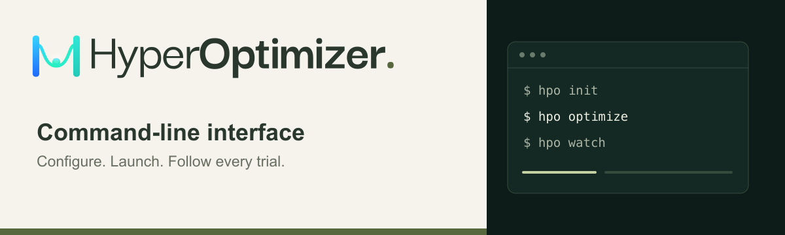

# HyperOptimizer CLI

[](https://github.com/hyperoptimizer/cli/actions/workflows/ci.yml)
[](LICENSE)

Run hyperparameter optimization experiments from your terminal.

`hpo` is the open-source command-line interface for [HyperOptimizer](https://hyperoptimizer.com). Configure your workload, build and push its Docker image, launch experiments, and follow trial results without leaving the command line.

[Documentation](https://docs.hyperoptimizer.com) · [Releases](https://github.com/hyperoptimizer/cli/releases) · [Report an issue](https://github.com/hyperoptimizer/cli/issues)

```sh
hpo login
hpo init
# Configure your workload in hpo.toml, then:
hpo optimize
```

Both `hpo` and `hyperoptimizer` run the same program and share credentials and configuration. Examples below use `hpo`.

## Installation

### Homebrew (macOS and Linux)

Add the official tap once, then install:

```sh
brew tap hyperoptimizer/cli https://github.com/hyperoptimizer/cli.git
brew trust --cask hyperoptimizer/cli/hyperoptimizer
brew install hyperoptimizer
hpo version
```

This downloads prebuilt binaries for your platform and installs both `hpo` and
`hyperoptimizer`, plus shell completions for `hpo` in Bash, Zsh, and Fish. Go is
not required. Use current Homebrew on macOS or Linux. Docker with Buildx is
required separately when building workloads.

To upgrade or uninstall:

```sh
brew update
brew upgrade hyperoptimizer
# To remove the CLI:
brew uninstall hyperoptimizer
```

The initial `brew tap` command is required because the cask lives in this
repository. Installing by name on a fresh Homebrew installation without adding
the tap requires distribution through Homebrew’s default repositories; this
package is distributed through our tap.
See [Homebrew maintenance](HOMEBREW.md) for release and testing instructions.

### Download a release

Download the archive for your platform from [GitHub Releases](https://github.com/hyperoptimizer/cli/releases):

| Platform | Architectures | Archive |
| --- | --- | --- |
| macOS | Intel (`amd64`), Apple Silicon (`arm64`) | `.tar.gz` |
| Linux | `amd64`, `arm64` | `.tar.gz` |
| Windows | `amd64`, `arm64` | `.zip` |

[Verify the download](VERIFYING.md), extract it, and place `hpo` (or `hpo.exe` on Windows) in a directory on your `PATH`. The archive also includes the `hyperoptimizer` alias.

Check your installation:

```sh
hpo version
```

### Linux packages (Debian/Ubuntu and Fedora/RHEL)

Download the `.deb` or `.rpm` matching your architecture from
[GitHub Releases](https://github.com/hyperoptimizer/cli/releases) and
[verify it](VERIFYING.md), then install the local package:

```sh
# Debian/Ubuntu (example version and architecture):
sudo apt install ./hyperoptimizer_0.2.0_amd64.deb
# Fedora/RHEL:
sudo dnf install ./hyperoptimizer_0.2.0_amd64.rpm
```

Both packages provide `hpo` and `hyperoptimizer`. Package files will be available
starting with the first GoReleaser release; the existing v0.1.0 release has archives only.
These downloads do not configure an APT or YUM repository for automatic updates.

### Build from source

Use the Go version specified in [go.mod](go.mod).

```sh
git clone https://github.com/hyperoptimizer/cli.git
cd cli
go build -o dist/hpo ./cmd/hpo
```

On macOS and Linux, install both command names with:

```sh
sh install.sh dist/hpo "$HOME/.local/bin"
```

Make sure `$HOME/.local/bin` is on your `PATH`. The installer refuses to overwrite an existing `hpo` or `hyperoptimizer` command.

## Getting started

You'll need a HyperOptimizer account and access to an organization. Building a local workload also requires Docker with Buildx.

### 1. Connect your account

```sh
hpo login
```

Follow the displayed URL, enter the code, and approve the connection. The CLI asks before opening your browser, then lets you choose a default organization.

For SSH or a terminal without a browser, use `hpo login --no-browser` and open the displayed URL on another device. Login codes expire after ten minutes.

### 2. Set up your project

From your workload directory, select an existing project and generate `hpo.toml`:

```sh
hpo init
```

Or create a project:

```sh
hpo init --create-project "My first experiment"
```

Edit `hpo.toml` to configure your image or build, parameters, objectives, and trial limits. Set any environment variables listed in `requiredEnv`. Init never overwrites an existing file.

### 3. Launch an experiment

```sh
hpo fmt
hpo validate
hpo optimize
```

The CLI validates your configuration, builds and pushes your image when `[build]` is present, and launches the experiment. Trial results appear in your terminal as the experiment runs.

> **Workload networking:** Unpaid subscription trials run without network access. Bundle dependencies and datasets in your image. Paid runtime downloads require approved destinations. See [network access](https://docs.hyperoptimizer.com/concepts/sandboxing-network-access).

## Common commands

| Command | Description |
| --- | --- |
| `hpo login` | Connect your account |
| `hpo auth status` | Check the active credential and API endpoint |
| `hpo org list` | List organizations, plans, and subscription status |
| `hpo org use <id-or-slug>` | Set your default organization |
| `hpo project create <name>` | Create a project without writing local files |
| `hpo project list` | List projects in the selected organization |
| `hpo experiment show <id>` | Inspect an experiment and its current progress |
| `hpo experiment pause/resume <id>` | Request a runtime state change |
| `hpo experiment best <id>` | Retrieve winning parameters or Pareto results |
| `hpo run list --experiment <id>` | Inspect and export all trials |
| `hpo run show <id>` | Inspect one run, including parameters and errors |
| `hpo logs <id> [--follow]` | Read workload logs for an experiment |
| `hpo experiment list` | List optimization and external tracking experiments |
| `hpo init` | Create a project configuration |
| `hpo fmt` | Format your configuration |
| `hpo validate` | Validate your configuration with the service |
| `hpo optimize` | Launch an experiment and watch its progress |
| `hpo watch <experiment-id>` | Follow an existing experiment |
| `hpo stop <experiment-id>` | Stop scheduling new trials |
| `hpo logout` | Remove locally saved credentials |

Use `hpo --help` or `hpo <command> --help` for available options. Shell completions are available through `hpo completion <bash|zsh|fish|powershell>`.

## Configuration

By default, commands read `hpo.toml` in the current directory. Use `--config` to select another file:

```sh
hpo validate --config path/to/hpo.toml
```

- **Build locally:** Include `[build]` to build with Docker Buildx and push an immutable image to your organization's registry. Build context and Dockerfile paths are relative to the configuration file.
- **Use an existing image:** Omit `[build]` and configure `[dockerImage]`.
- **Define the search:** Each `[[parameters]]` block defines a parameter. Slugs become trial flags, such as `--hpo-learning-rate`.
- **Track objectives:** Each `[[objectives]]` block defines a metric and its optimization direction. Multiple objectives are tracked independently.

Use the [generated template](internal/config/template.toml) as a reference, or export a configuration from the dashboard. Keep credentials out of `hpo.toml` and add `.hpo/` to your project's `.gitignore`.

For local checks without an account:

```sh
hpo fmt --check
hpo validate --offline
```

`fmt --check` exits with code 2 if formatting is needed. Offline validation checks structure only; semantic and organization checks require online validation. Image and launch-time checks run during `optimize`.

### Organizations and projects

```sh
hpo org list
hpo org use my-team
hpo project create "Trading strategies"
hpo project list
hpo experiment list --project <project-id>
```

Pass `--org <id-or-slug>` to use a different organization for one command without changing your default. Organization selection follows `--org`, then `HPO_ORG`, then the saved default. Pass `--project <project-id>` to override the project in your configuration.

## Monitoring experiments

Launch in the background, then reconnect when you need to:

```sh
hpo optimize --detach
hpo watch <experiment-id>
hpo experiment show <experiment-id>
hpo experiment pause <experiment-id>
hpo experiment resume <experiment-id>
hpo stop <experiment-id>
```

Pressing **Ctrl+C** while watching detaches your terminal; the experiment keeps running in the cloud. `stop` prevents new trials and lets running trials finish, so a gracefully stopped experiment can still finish as `completed`.

Use `hpo optimize --paused --detach` to create a paused experiment without starting execution, then `hpo experiment resume <id>` to start it. Control commands confirm the requested state; actual runtime status may take time to converge. Finished or stopping experiments cannot pause or resume.

ID-based commands resolve resources within the selected organization and work without `hpo.toml`. An explicit `--project` restricts the lookup; a mismatching project fails rather than changing the target. External tracking experiments support summaries, run inspection, and logs; optimization controls and best-result ranking require managed optimization experiments.

### Trial results and exports

```sh
hpo run list --experiment <id>
hpo run show <run-id>
hpo run list --experiment <id> --output csv > results.csv
hpo experiment best <id>
hpo experiment best <id> --objective accuracy --output jsonl
hpo experiment best <id> --pareto --output csv > pareto.csv
```

Run lists paginate through the entire history. CSV exports use sorted `parameter.<key>` and `metric.<key>` columns, plus run identity, status, finalization, error, and timestamp columns; missing values are empty cells. JSONL preserves numeric, boolean, and string parameter types. Complete finalizations read immutable final metrics; unfinalized runs show live aggregated metrics.

Best results require successful, fully finalized, optimizer-accepted trials containing every objective. A single objective uses its configured minimize/maximize direction and retains ties. Multiple objectives return all non-dominated runs (the Pareto front), without a combined score. `--objective <key>` ranks eligible runs by that objective alone; `--pareto` explicitly selects all objectives. These flags are mutually exclusive. Results reflect the data fetched during the command, not a frozen database snapshot.

### Workload logs

```sh
hpo logs <experiment-id> --since 30m
hpo logs <experiment-id> --run <run-id> --follow
hpo logs <experiment-id> --output jsonl
```

Logs print oldest first with timestamp, level, and run identity. The default look-back is one hour and the default per-window limit is 1,000 entries. Use `--since` with a positive Go duration and `--limit` up to 10,000. A larger matching window fails with guidance before printing that window, rather than silently truncating. Follow mode polls every two seconds and rechecks a 30-second overlap for delayed ingestion, preserving repeated identical entries. Logs arriving more than 30 seconds late may require a fresh historical query. The storage API does not provide a snapshot cursor, so concurrent ingestion can affect offset paging. Retention and provider availability also apply. Ctrl+C exits follow mode.

Pause/resume require `experiments_read` and `experiments_write`; summaries require `experiments_read` and `runs_read`; best results and run lists require `experiments_read` and `runs_read`. Logs require `experiments_read` and `logs_read` (plus `runs_read` with `--run`). Existing personal CLI credentials issued without `logs_read` need a new browser login after the backend update. Organization keys must be issued with the needed scopes. A set `HPO_API_KEY` continues to override saved credentials.

If a launch times out, the CLI saves recovery state in `.hpo/launch.json`. Rerun the same command with unchanged configuration and required environment values to recover the original experiment. Check the dashboard before deleting pending recovery state. After a successful launch, another `optimize` creates a new experiment.

## CI and automation

Set `HPO_API_KEY` through your CI secret store. For a personal API key, also select an organization with `HPO_ORG` or `--org`; environment credentials do not inherit a saved login's default organization.

```sh
# HPO_API_KEY and HPO_ORG are provided by your CI environment.
hpo fmt --check
hpo validate
hpo optimize --detach --output jsonl
```

`--output jsonl` writes versioned structured events to stdout and diagnostics to stderr. Use `--output plain` for readable logs and borderless lists. The default, `auto`, chooses rounded tables in a terminal and plain output when redirected (or with `TERM=dumb`). `--output table` explicitly selects tables; live monitoring requires a terminal.

Organization, project, and experiment lists share a Unicode-aware table renderer. Long cells wrap to the terminal width without dropping values. Resource lists, experiment/run summaries, and best results also support CSV and Markdown exports; these formats are rejected for mutations, logs, and live monitoring. Empty exports include column headers, while empty human-readable lists show a helpful message. CSV retains original field values, including commas, quotes, and newlines. JSONL retains the full API records and existing event envelope.

```sh
hpo project list --output table
hpo experiment list --output csv > experiments.csv
hpo org list --output markdown > organizations.md
hpo experiment list --output jsonl | jq '.experiments'
```

Static tables use [go-pretty](https://github.com/jedib0t/go-pretty); CSV uses Go's `encoding/csv` for lossless quoting. Live monitoring continues to use Bubble Tea/Bubbles.

### Authentication and privacy

Credentials are stored in your operating system's credential store. You can also pipe a key to `hpo login --api-key-stdin`. On Unix, `--credential-file <path>` explicitly selects protected local file storage.

`HPO_API_KEY` takes precedence over saved credentials. An empty or rejected environment key fails authentication rather than falling back. `hpo logout` removes the selected local credential; it does not unset environment variables or revoke server-side keys. Revoke keys in the dashboard when needed.

Telemetry is disabled by default. Setting `BETTER_STACK_CLI_DSN` explicitly opts into redacted error reporting to that Sentry-compatible endpoint. Official builds contain no monitoring endpoint or credential.

### Exit codes

| Code | Meaning |
| --- | --- |
| `0` | Success |
| `1` | Failed or cancelled experiment |
| `2` | Usage or configuration error |
| `3` | Authentication error |
| `4` | Authorization error |
| `5` | Service or transport error |
| `130` | Interrupted |

A failed trial alone does not fail the experiment.

## Development

Build and run the tests with the Go version specified in [go.mod](go.mod):

```sh
go test -race ./...
go build -o dist/hpo ./cmd/hpo
```

Unit tests require no account, backend secrets, or private source. To work against a local API, set `HPO_API_URL=http://127.0.0.1:8186`. Normal use defaults to `https://graphql.hyperoptimizer.com`. `--api-url` overrides `HPO_API_URL`; credentials are scoped to the selected endpoint, so log in again when changing origins.

For API client generation and schema updates, see [CONTRACTS.md](CONTRACTS.md). For release builds, checksums, and provenance, see [VERIFYING.md](VERIFYING.md).

## Feedback and security

Found a bug or have a feature request? [Open an issue](https://github.com/hyperoptimizer/cli/issues). Include your CLI version and steps to reproduce, with credentials and sensitive data removed.

Report vulnerabilities privately using the process in [SECURITY.md](SECURITY.md).

## License

[MIT](LICENSE) © HyperOptimizer
